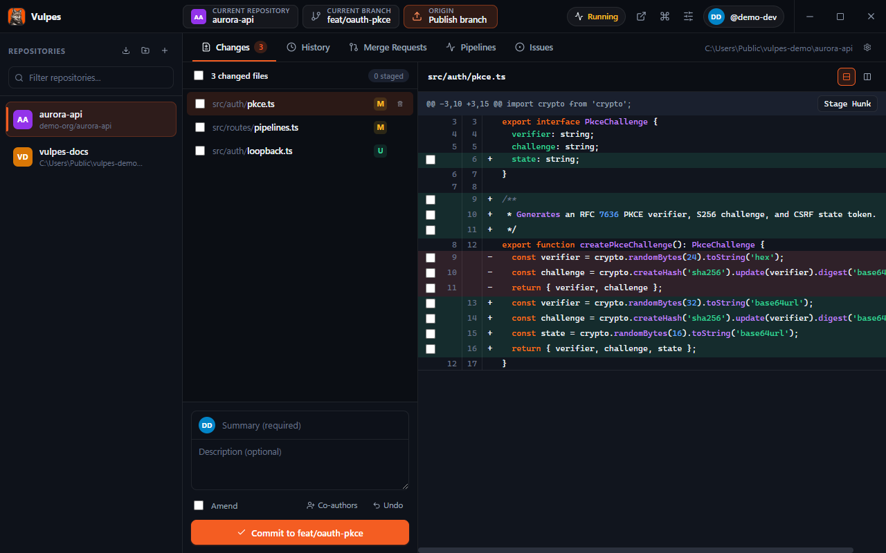
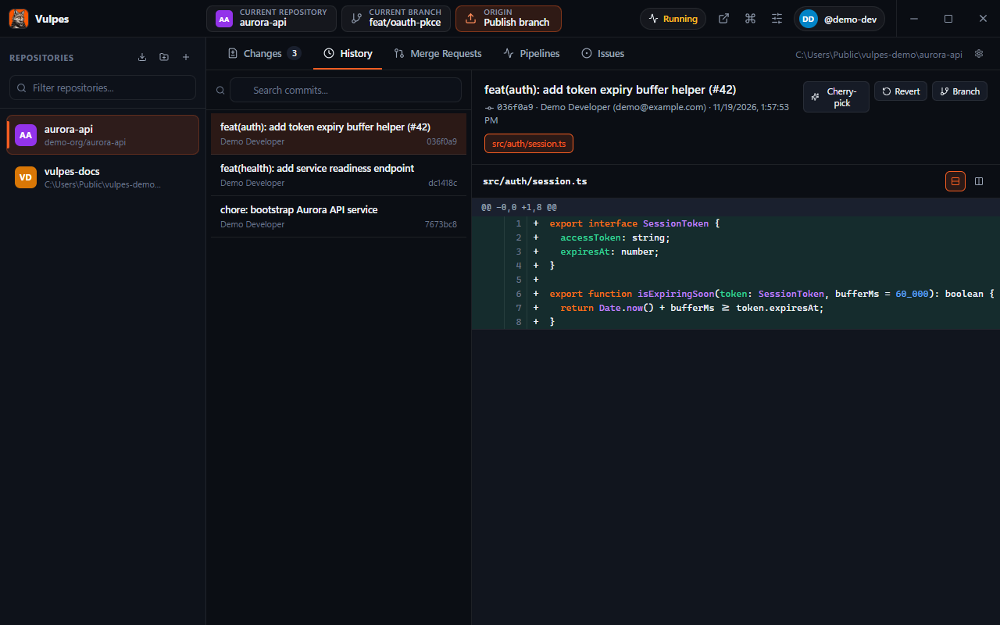
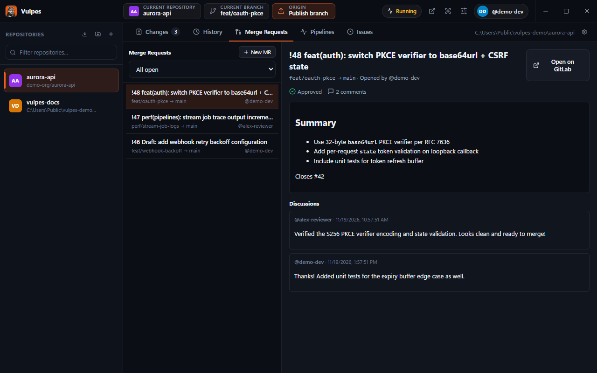
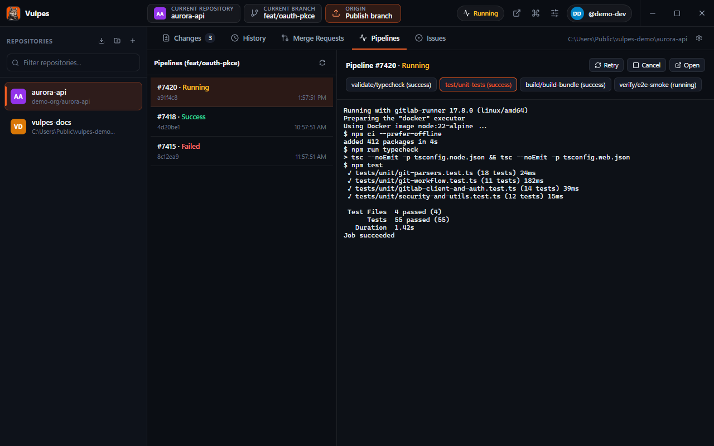
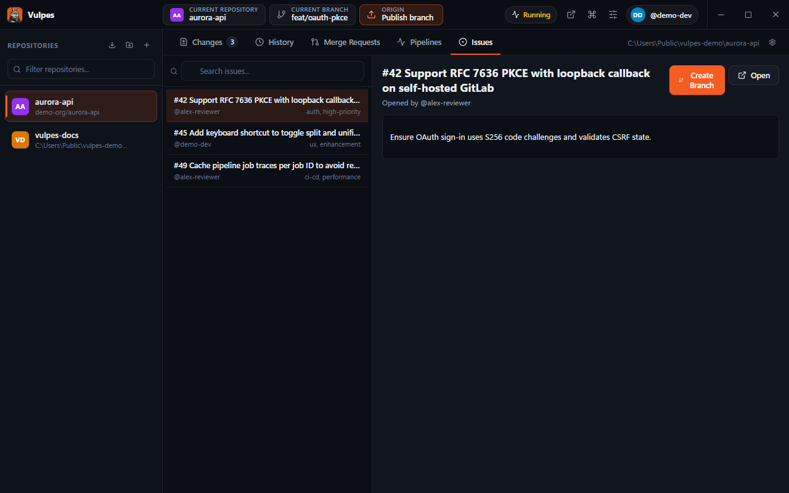
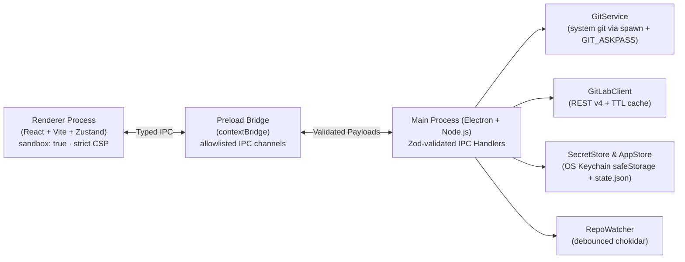

<div align="center">
  
  <h1>Vulpes</h1>
  <p>A fast, focused cross-platform desktop Git &amp; GitLab client.</p>
  <p>
    <a href="https://github.com/projectGloria/Vulpes/actions/workflows/release.yml"></a>
    <a href="https://github.com/projectGloria/Vulpes/releases"></a>
    
    
  </p>
</div>

<p align="center">
  
</p>

<p align="center">
  <a href="#about">About</a> ·
  <a href="#features">Features</a> ·
  <a href="#screenshots">Screenshots</a> ·
  <a href="#how-it-works">How It Works</a> ·
  <a href="#installation">Installation</a> ·
  <a href="#usage">Usage</a> ·
  <a href="#building-from-source">Building from Source</a> ·
  <a href="#contributing">Contributing</a> ·
  <a href="#license">License</a>
</p>

## About

**Vulpes** is a cross-platform desktop Git client built for the everyday Git + GitLab workflow on Windows, macOS, and Linux. Modeled on the simplicity of GitHub Desktop, it pairs fast local Git operations (partial hunk/line staging, history inspection, conflict resolution, and recoverable discards) with native GitLab integration for Merge Requests, CI/CD Pipelines, and Issues across both `gitlab.com` and self-hosted GitLab instances.

## Features

- **Multi-Repository Workspace**: Manage multiple local repositories in a filterable sidebar, add existing folders, initialize new repos, or clone from GitLab/URL with cancellable live progress and automatic GitLab project detection.
- **Partial Staging & Diff Viewer**: Stage individual files, hunks, or lines in Unified diff mode, inspect side-by-side Split diffs with syntax highlighting and image diffs, commit/amend/undo with co-author support, and recover discarded changes from local backups.
- **Branch, Stash & History Tools**: Create, switch, rename, and delete branches; manage stashes; fetch, pull (`merge`, `rebase`, or `ff-only`), push, and publish branches; search commit history to cherry-pick, revert, or branch from any commit; and resolve merge/rebase conflicts.
- **GitLab Merge Requests, Pipelines & Issues**: Browse and filter MRs with sanitized Markdown descriptions, approvals, and discussions; create MRs directly after publishing a branch; monitor CI/CD pipelines, inspect job logs, and retry/cancel runs; and create issue-linked branches (`123-slug`) from open issues.
- **Secure Multi-Instance Auth**: Sign in to `gitlab.com` or self-hosted GitLab via OAuth 2.0 Authorization Code + PKCE (system browser + loopback callback) or Personal Access Token. Tokens are encrypted in the OS keychain (`safeStorage`) and injected transiently into HTTPS Git commands via an ephemeral `GIT_ASKPASS` bridge; SSH keys work natively.
- **Keyboard-First Desktop Polish**: Light, dark, and system themes, Command Palette (`Ctrl/Cmd+K`), global shortcuts, desktop notifications, structured redacted file logging, and automatic updates via `electron-updater`.

## Screenshots

<p align="center">
  
  <br /><em>History: search commits, inspect changed files, and cherry-pick, revert, or branch from any commit.</em>
</p>

<p align="center">
  
  <br /><em>Merge Requests: filter open MRs, review sanitized Markdown descriptions, approvals, and discussion threads.</em>
</p>

<p align="center">
  
  <br /><em>CI/CD Pipelines: track branch pipeline status, inspect stage jobs and trace logs, and retry or cancel runs.</em>
</p>

<p align="center">
  
  <br /><em>Issues: browse and search project issues and spin up issue-linked branches in one click.</em>
</p>

## How It Works



Vulpes enforces strict Electron process isolation: the sandboxed React renderer has no direct access to Node.js, the filesystem, Git, or OS credentials. All actions pass through an allowlisted `contextBridge` preload script and are validated with Zod schemas in the main process before invoking the system `git` binary via argument arrays (no shell interpolation), the GitLab REST v4 API, or Electron's `safeStorage` keychain wrapper. See [ARCHITECTURE.md](ARCHITECTURE.md) for the full design and security model.

## Installation

### Download a Release

Download the latest installer for your platform from the [GitHub Releases](https://github.com/projectGloria/Vulpes/releases) page:

- **Windows (x64)**: `Vulpes-Setup-<version>.exe` (NSIS installer)
- **macOS**: `Vulpes-<version>-<arch>.dmg` or `.zip`
- **Linux**: `Vulpes-<version>-<arch>.AppImage` or `.deb`

### System Requirements

- **Git** installed and available on your `PATH` (if missing, Vulpes displays a banner with a download link and retry button).
- A **GitLab.com** or **self-hosted GitLab** account (optional for local-only Git repositories).

### First Run

1. Launch **Vulpes**.
2. Click **Sign in** in the top-right toolbar to connect a GitLab account using **OAuth 2.0 (Browser)** or a **Personal Access Token**.
3. Click **Clone Repository**, **Add Local Repository**, or **Create New Repository** to open your first project.

## Usage

### Common Workflows

1. **Stage & Commit Selectively**: Open the **Changes** tab (`Ctrl/Cmd+1`), select a modified file, use **Stage Hunk** or individual line checkboxes in Unified diff mode, enter a summary, and commit (with optional **Amend**, **Co-authors**, or **Undo**).
2. **Publish & Open a Merge Request**: Create or switch branches (`Ctrl/Cmd+B`), click **Publish branch** in the toolbar, and use the post-publish prompt (or **Merge Requests → + New MR**) to open a Merge Request on GitLab.
3. **Start Work from an Issue**: Open the **Issues** tab (`Ctrl/Cmd+5`), select an issue, and click **Create Branch** to create an issue-linked branch (`123-slug`).

### Keyboard Shortcuts

| Shortcut | Action |
| --- | --- |
| `Ctrl/Cmd + K` | Open Command Palette |
| `Ctrl/Cmd + ,` | Open Preferences |
| `Ctrl/Cmd + B` | Open Branches dialog |
| `Ctrl/Cmd + Shift + O` | Clone Repository |
| `Ctrl/Cmd + R` | Refresh repository status |
| `Ctrl/Cmd + 1` – `5` | Switch tabs (Changes, History, Merge Requests, Pipelines, Issues) |
| `Esc` | Close active dialog |

## Building from Source

### Prerequisites

- **Node.js** 20+ (CI builds with Node.js 22) and **npm** 10+
- **Git** installed and available on `PATH`

### Development & Build Steps

1. Clone the repository and install dependencies:
   ```bash
   git clone https://github.com/projectGloria/Vulpes.git
   cd Vulpes
   npm install
   ```
   If npm blocks postinstall scripts (for example with npm 11+ `allowScripts`), download the Electron binary manually:
   ```bash
   node node_modules/electron/install.js
   ```
2. Start the app in development mode with hot reload:
   ```bash
   npm run dev
   ```
3. Run type-checking, unit tests, and production bundle build:
   ```bash
   npm run typecheck
   npm test
   npm run build
   ```
4. Run Playwright end-to-end tests (requires a completed `npm run build` and Electron binary):
   ```bash
   npm run test:e2e
   ```
5. Package unpacked binaries (for local testing) or full platform installers into `release/`:
   ```bash
   npm run package:dir
   npm run package
   ```

## Configuration & Known Limitations

<details>
<summary>Registering a GitLab OAuth 2.0 + PKCE Application for Development</summary>

To sign in with **OAuth 2.0 + PKCE** on `gitlab.com` or a self-hosted GitLab instance:

1. Open GitLab and go to **User Settings → Applications** (or Group/Admin Applications for self-hosted instances).
2. Click **Add new application** and configure:
   - **Name**: `Vulpes (Dev)`
   - **Redirect URI**: `http://127.0.0.1:42891/oauth/callback`
   - **Confidential**: **Unchecked** (public native client using PKCE)
   - **Scopes**: `api`, `read_user`, `read_repository`, `write_repository`
3. Save the application and copy the **Application ID** (`client_id`).
4. In Vulpes, click **Sign in → OAuth 2.0 (Browser)**, enter your instance URL and Application ID, and click **Sign in with Browser**.

</details>

<details>
<summary>Known Limitations</summary>

- **System Git dependency**: Vulpes uses the system `git` binary on `PATH` rather than bundling `dugite`.
- **Line-level staging in Split mode**: Hunk and line checkboxes are available in Unified diff mode; Split mode is read-only for side-by-side inspection.
- **OAuth loopback on older self-hosted GitLab**: Instances that do not support RFC 8252 loopback redirects should use the Personal Access Token sign-in flow.
- **Inline MR diff comments**: Merge Request discussions and approvals are viewable in-app, while creating new inline diff review threads opens the MR on GitLab.

</details>

## Contributing

Contributions are welcome. Please read [CONTRIBUTING.md](CONTRIBUTING.md) for the development workflow, TypeScript strict-mode rules, IPC validation guidelines, and security standards before opening a pull request.

## License

Vulpes is licensed under the [MIT License](LICENSE).
